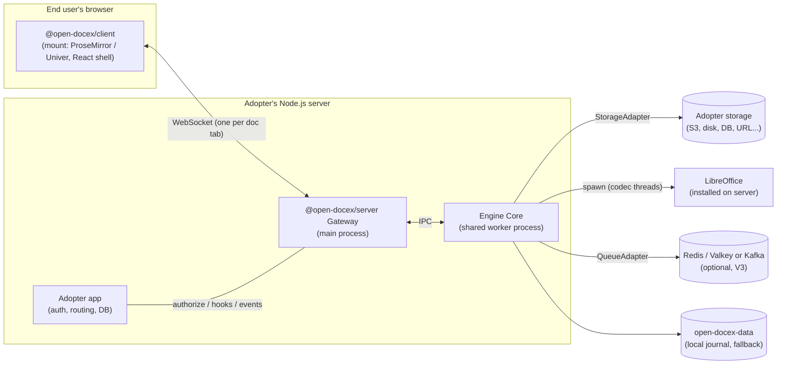
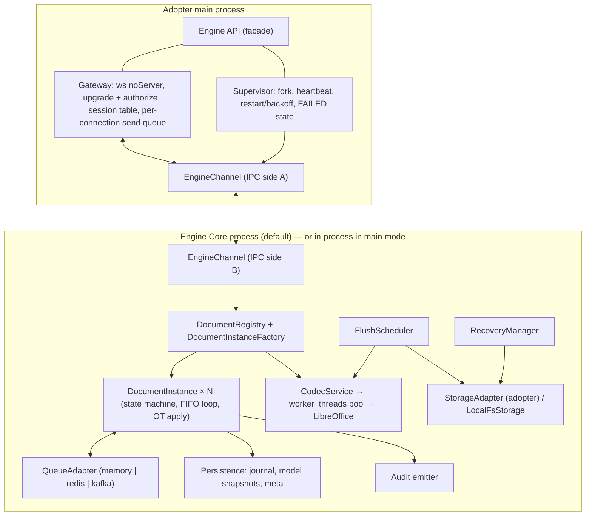
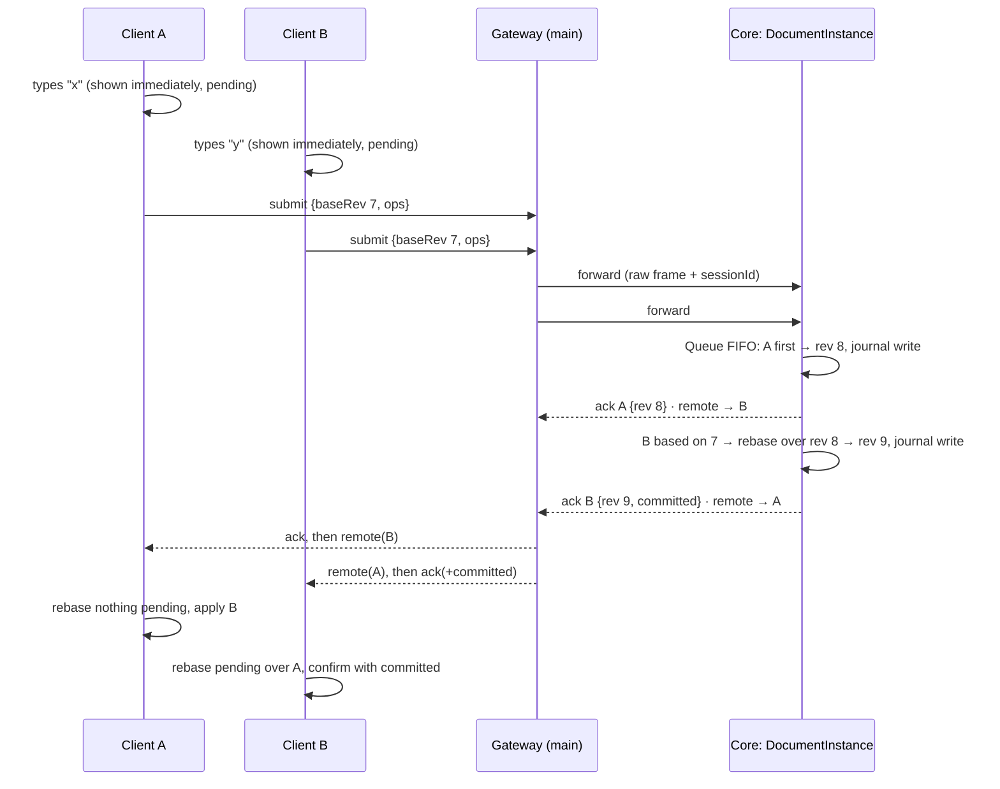
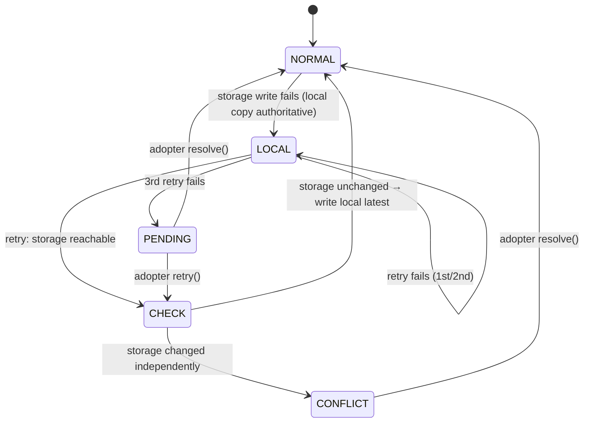

# open_docex — High-Level Design (HLD)

| | |
|---|---|
| **Status** | Master document. Source of truth for implementation, together with `LLD.md`. |
| **Scope source** | BRD: `draft_description_of_the_product_package.docx` (original draft, Addendum §1–§6, Add-on A/B, Add-ons 2–4) |
| **Release plan** | `VERSION_PLAN.md` (V1–V7) and `EXECUTION_PLAN.md` |
| **Author** | Claude, at the project owner's request (2026-11-18) |
| **Change rule** | Contracts and decisions here change only with the project owner's approval. `LLD.md` is updated in the same commit. |

References in brackets point to the BRD, e.g. [§4], [A5], [Add-on 3 §5]. **PO** marks a project-owner decision. **CL** marks a design decision by Claude, open to the project owner's review.

---

## 1. Purpose and scope

open_docex is an open-source (MIT) set of npm packages for real-time collaborative editing of word-processor documents and spreadsheets [Draft; §1].

- The **backend engine** runs inside the adopter's Node.js backend. It is the only authority on document state and change order [§3].
- The **frontend package** provides a customizable editor UI that connects to the engine. It is used for editing and for view-only access [Draft; §1].
- The adopter controls storage, deployment, authentication, permissions, share-link policy and audit retention. The package provides none of these services [§1].
- The package does keep storage of its own in three places [Main rule; §4; A5]:
  - the local fallback folder
  - the local change journal
  - the incoming queues

**In scope:** everything recorded in the BRD, delivered as V1–V7 in `VERSION_PLAN.md`.

**Out of scope:** anything not in the BRD. This includes:
- authentication, authorization and share-link services
- audit-log storage
- coordinating several independently run adopter servers [§6; B5]

---

## 2. Requirements summary

### 2.1 Functional (main own-OT scope, V1–V5)

| # | Requirement | Source | Version |
|---|---|---|---|
| F1 | A factory creates one collaboration instance per document or spreadsheet. | Draft; §1 | V1/V2 |
| F2 | Concurrent editing, merged by our own server-sequenced OT. Converges on all screens. | A1; §3; Add-on 3 §3 | V1/V2 |
| F3 | FIFO processing per document. Each change is saved, then broadcast to the others. The engine does not wait for screens. | Draft; §2 | V1 |
| F4 | Configurable incoming queue: bounded in-memory (V1), Redis or Kafka (V3), with backpressure. | Draft CONFIGURABLE; §2; A3; PO | V1/V3 |
| F5 | Shows the user's own typing immediately. Receives patches, not reloads, and keeps the user's unconfirmed typing, cursor and selection. | §3 | V1 |
| F6 | The sender gets an acknowledgement with the assigned revision. | A6 | V1 |
| F7 | First load is streamed in chunks from a snapshot at revision N; the client buffers later changes. | Draft; A7 | V1 |
| F8 | Runs in a shared worker process (default) or in the main process. | Draft CONFIGURABLE; §2 | V1 |
| F9 | Engine failure: supervision, restart with backoff, error model, per-instance isolation. | MAIN; A2 | V1 |
| F10 | Saving: local journal plus periodic snapshot export to the adopter's storage. The storage interface exposes a version/ETag. | A5 | V1 |
| F11 | Storage failure: switch to a durable local copy, retry 3 times (1/5/15 min), mark pending, check for conflicts before writing back. | §4; §5; A4 | V1 |
| F12 | Document sources: the adopter's reference (path or URL), the local fallback, a new blank document. | §1; Add-on 3 §5; PO | V1 |
| F13 | Adopter access check before a session opens and before changes are accepted. WebSocket upgrade on the adopter's HTTP server. | §1; A9 | V1 |
| F14 | View-only sessions. Document ID plus share hook. The connection stays open for the session. | Draft; Add-on 3 §5 | V1 |
| F15 | Change events stream out as audit data. | §3; §6 | V1 |
| F16 | Formats: .docx, .odt, .xlsx, .ods, converted through LibreOffice on the server. | PO 2026-11-18 | V1/V2 |
| F17 | Supported document content: see §8.1. | PO 2026-11-18 | V1 |
| F18 | Spreadsheets: cells, formulas (last saved value, references shifted on row/column changes), formatting, layout. The later change wins on the same cell. | §6; Add-on 3 §5; PO | V2 |
| F19 | Unsupported content: the document opens read-only with a warning. The adopter can allow "edit anyway". | PO 2026-11-18 | V1 |
| F20 | End-user upload from the user's device, streamed into the backend. | Draft; §1 | V4 |
| F21 | Bookmarks and side notes/reviews, stored through adopter-supplied storage. | Draft; A8 | V5 |

### 2.2 Non-functional

| # | Requirement | Source |
|---|---|---|
| N1 | **Durability:** no accepted change is lost on an engine or process crash. A change is acknowledged only after its journal write completes. | A5; Add-on 2; Add-on 3 §6 |
| N2 | **Availability:** a worker crash triggers automatic restart. One faulty document does not stop the others. | A2 |
| N3 | **Scale:** thousands of connections per server. All limits are configurable with conservative defaults, and real numbers come from a benchmark task. | Draft; PO 2026-11-18 |
| N4 | **Main-process load:** collaboration work runs outside the adopter's main process by default. | Draft; §2 |
| N5 | **Licensing:** MIT. Dependencies must be MIT, BSD or Apache-2.0. LibreOffice (MPL-2.0) is an external program, not bundled. | Add-on 4; PO |
| N6 | **Engineering baseline:** SOLID, design patterns used where they solve a real problem, clean architecture, YAGNI, KISS. | Draft "Design decisions" |
| N7 | **Errors:** structured, actionable errors so the adopter can resolve them. | MAIN; A2 |

---

## 3. Decision log

### 3.1 Project-owner decisions (2026-11-18)

| ID | Decision |
|---|---|
| PO-1 | HLD and LLD are Markdown files in the repo root. They are the master documents. |
| PO-2 | TypeScript for all packages. |
| PO-3 | Three packages: `@open-docex/server` (`backend/`), `@open-docex/client` (`frontend/`), `@open-docex/shared` (`shared/`). |
| PO-4 | Scale: configurable limits. A benchmark task sets the real numbers. |
| PO-5 | File formats: .docx, .xlsx, .odt, .ods. |
| PO-6 | Conversion uses LibreOffice installed on the server, not bundled. |
| PO-7 | The Redis/Kafka option applies to the incoming queue only. Outgoing broadcast uses an in-memory FIFO per connection. |
| PO-8 | Document URLs and paths are resolved by the adopter's storage adapter. The package ships only a local-filesystem adapter. |
| PO-9 | V2 shifts formula references when rows or columns are inserted or deleted. |
| PO-10 | The text editor is ProseMirror (MIT). |
| PO-11 | The spreadsheet editor is Univer, Apache-2.0 core only. No `@univerjs-pro/*`. |
| PO-12 | Client UI uses React internally, exposed through a `mount(element, options)` API. Web Components remain B6 (V6). |
| PO-13 | Unsupported content opens read-only with a warning. The adopter may allow "edit anyway", which removes those parts on save. |
| PO-14 | V1 document content: core text, tables, images, page layout. |
| PO-15 | V2 spreadsheet content: core cells, cell formatting, layout. Advanced features are unsupported. |

### 3.2 Claude design decisions (CL, open to review)

| ID | Decision | Why |
|---|---|---|
| CL-1 | The **Gateway** (WebSocket termination, access check) runs in the adopter's main process. The **Engine Core** runs in one forked child process. They talk over Node IPC with `serialization: 'advanced'`. | The adopter's auth code lives in the main process. Raw frames are forwarded without parsing, so main-process cost stays low (N4). A crash in a separate process can be supervised (A2). The BRD names a worker *process* [§2]. |
| CL-2 | Worker-side adopter code (storage adapter, queue settings) is given as a **worker config module path**. Main mode imports the same module in-process. | Functions can't be sent to a child process. One code path for both modes. |
| CL-3 | LibreOffice converts every format to and from **flat ODF** (FODT/FODS, single-file XML). Our mappers translate flat ODF to and from the editor models. | Keeps page layout, headers/footers, styles and formulas. One parser family for all four formats. No dependence on stagnant JS libraries (ExcelJS) or one-way ones (mammoth). |
| CL-4 | Codec work (LibreOffice spawn and XML mapping) runs in a **worker_threads pool** inside the engine process. | Large files would otherwise block the shared worker's event loop for every document and trip the heartbeat (A2). |
| CL-5 | Local durability is a model snapshot (JSON) plus an append-only NDJSON op journal per document. Export to storage happens on a flush policy. The ack is sent after the journal write resolves. The default fsync is periodic, with an "always" option. | Meets A5 and N1. A write that has resolved survives a process crash without fsync; fsync covers OS crashes. |
| CL-6 | **Text OT** works on ProseMirror steps. A shared, mapping-only `rebaseSteps` function is used by both server and client. When the server had to transform a batch, the ack echoes the committed steps, and the client corrects any difference. | Server-side transform as A1 requires. One function on both sides gives the same result, and the echo guarantees convergence in edge cases where a step was dropped. |
| CL-7 | Every loaded document instance has an **epoch** (random ID) as well as a revision. A client whose epoch doesn't match must resync. | Detects reloads and restarts safely. |
| CL-8 | Images are **content-addressed assets** sent over the same WebSocket (binary frames). There is no extra HTTP route. | Keeps one integration point and one access check (A9). |
| CL-9 | Page-layout scope (PO-14): one page style per document (size, orientation, margins), hard page breaks, one default header and one default footer. Different first-page or odd/even headers, and several sections with different page styles, count as unsupported. | The smallest reading of "page layout" that ProseMirror can represent without its own pagination model. |
| CL-10 | Node.js: supports the LTS lines 22, 24 and 26 (`engines: >=22.12`), with a CI matrix. Each line is dropped at its end-of-life. | Verified schedule: 26 Active LTS, 24/22 Maintenance. |
| CL-11 | V3 clients: `redis` (node-redis), using Streams. Valkey is compatible. Kafka uses `@confluentinc/kafka-javascript`. Both are optional peer dependencies. | node-redis is the Redis-recommended client. kafkajs has had no release since 2023-02. |
| CL-12 | Duplicate changes are detected by `(clientId, clientSeq)`. The table is persisted through the journal. | Lets clients resend after a reconnect or crash (A2). |
| CL-13 | One WebSocket per open document per browser tab. The document ID goes in the connect URL. | Session routing without parsing every frame in the Gateway. |
| CL-14 | The data directory defaults to `<process.cwd()>/open-docex-data` and is configurable. | Draft: "a folder specifically for this, created by us" in the root directory. |
| CL-15 | Tooling: npm workspaces; ESM-only packages with `.d.ts`; `tsc` for shared and server; Vite library mode for client; Vitest for unit and integration tests; Playwright for end-to-end tests. | Mainstream, MIT-licensed. |
| CL-16 | Univer's formula engine is **not registered** until V6. Cells show their last saved value. | Add-on 3 §5: no live recalculation before B3. |

---

## 4. System context



---

## 5. Repository and packages

```
open_docex/
  HLD.md  LLD.md  EXECUTION_PLAN.md  VERSION_PLAN.md  AGENTS.md  CLAUDE.md  LICENSE
  draft_description_of_the_product_package.docx      (BRD)
  package.json                                        (npm workspaces root, private)
  shared/    → @open-docex/shared   (isomorphic: no Node or DOM APIs)
  backend/   → @open-docex/server   (Node.js only)
  frontend/  → @open-docex/client   (browser only)
```

| Package | Contains | Depends on |
|---|---|---|
| `@open-docex/shared` | Protocol messages, error codes and the error shape, text schema and text OT (`rebaseSteps`), sheet model and sheet OT, formula reference shifting, chunking helpers, ID helpers | `prosemirror-model`, `prosemirror-transform`, `prosemirror-tables` (schema only) |
| `@open-docex/server` | Engine API, Gateway, Supervisor, Engine Core, adapters, persistence, recovery, codecs | shared, `ws`, XML parser; optional peers `redis`, `@confluentinc/kafka-javascript` |
| `@open-docex/client` | `mount()`, connection, sync clients, ProseMirror view, Univer bridge, React shell | shared, ProseMirror packages, `@univerjs/*` (pinned), React (peer) |

**Dependency rule:** `client → shared ← server`. The client never imports server code.

---

## 6. Runtime architecture



- **Worker mode (default) [§2]:**
  - One shared Engine Core process handles all instances. There is never one process per instance.
  - The Supervisor owns that process.
  - `EngineChannel` is IPC.
- **Main mode [§2]:**
  - Engine Core runs in the main process. `EngineChannel` becomes an in-process channel with the same interface (Bridge).
  - There is no Supervisor. The adopter's process manager restarts the app, and boot recovery runs on start (A2).
- **Codec threads (CL-4)** are a fixed pool, size configurable (default 1). Each LibreOffice conversion is a child process of a codec thread. It gets its own temporary user profile and is capped by `maxConcurrent`.

---

## 7. Backend components

| Component | Responsibility | Pattern (why) | Version |
|---|---|---|---|
| **Engine API** | `createEngine(options)`: attach to the HTTP server, events, document creation, recovery and session admin, shutdown | Facade (one small adopter surface over many parts) | V1 |
| **Gateway** | Handles `upgrade` on the adopter's server for the configured path; calls `authorize`; builds a `Session`; keeps the session table; forwards raw frames to the Core; writes outgoing frames through a per-connection FIFO with a high-water mark. Too slow a reader is disconnected with `SESSION_SLOW_CONSUMER`. Runs `canSubmit` when configured. | — | V1 |
| **Supervisor** | Forks the Core; heartbeat ping every 5 s, 15 s timeout; restarts with 1/2/4/8/16 s backoff; at most 5 restarts in 10 min, then `FAILED`. | State machine (see §11) | V1 |
| **EngineChannel** | Typed request/response and event channel between main and Core. Two implementations: IPC and in-process. | Bridge (the same API over two transports) | V1 |
| **DocumentRegistry / DocumentInstanceFactory** | Finds or creates the instance for a `documentId`. The factory builds a text or sheet instance with its `OtType`, codec and policies. | Factory (two kinds, construction depends on config) [Draft "factory"] | V1/V2 |
| **DocumentInstance** | Lifecycle state machine; FIFO processing loop; apply/transform through `OtType`; journal write then ack; broadcast; audit; fault isolation | State (lifecycle) | V1 |
| **OtType (shared)** | `TextOtType` (ProseMirror steps), `SheetOtType` (sheet ops) | Strategy (two merge algorithms behind one interface) | V1/V2 |
| **QueueAdapter** | Per-document bounded FIFO. `enqueue` returns accepted or `QUEUE_FULL`; one consumer per document. | Adapter (memory, Redis, Kafka) [CONFIGURABLE] | V1 (memory), V3 |
| **Persistence** | Journal (NDJSON), model snapshots (JSON), per-document meta, content-addressed assets, under `dataDir` | Repository-style module (one owner of the local file layout) | V1 |
| **StorageAdapter** | Adopter port: `read`, `write` (with `expectedVersion`), `stat`, `create`. `LocalFsStorage` is built in; it is the fallback, and adopters may also use it as their own storage. | Port/Adapter (adopter-pluggable) [§1; A5; PO-8] | V1 |
| **FlushScheduler** | Exports the model to file bytes and writes them to storage after a quiet period or a maximum interval; trims the journal after success | — | V1 |
| **RecoveryManager** | §4/§5 state machine (§11.3); retries at 1/5/15 min; conflict check; pending list; adopter actions | State | V1 |
| **CodecService** | `import(bytes, format)` produces the model plus unsupported findings; `export(model, format)` produces bytes. Uses LibreOffice ↔ flat ODF plus our mappers, run on the codec thread pool. | Strategy per format family | V1/V2 |
| **Audit emitter** | Emits each applied op as an `audit` event with user, revision, time, and superseded values for cells [§6] | Observer | V1 |
| **AnnotationService** | Bookmarks and side notes. Anchors live in the document model (synced by OT); note content goes through the adopter's `AnnotationStore`. | Port/Adapter | V5 |
| **UploadService** | Upload sessions: the file is streamed over the WebSocket, validated, and created in storage | — | V4 |

**Deliberately not introduced:** dependency-injection containers, an event-sourcing framework, CQRS, microservices, a cache layer. None solves a present problem here.

---

## 8. Data model

### 8.1 Text document model (ProseMirror schema in `@open-docex/shared`)

- **`doc`** has page attributes `{ size, orientation, margins }` and contains `header?`, `body`, `footer?` (CL-9).
- **Block nodes:**
  - `paragraph` (alignment)
  - `heading` (levels 1–6)
  - `bullet_list`, `ordered_list`, `list_item`
  - `table`, `table_row`, `table_cell`, `table_header` (prosemirror-tables; merged cells via colspan/rowspan)
  - `image` (`assetId`, alt text, width, height)
  - `page_break`
- **Inline nodes:** `text`, `hard_break`.
- **Marks:** `bold`, `italic`, `underline`, `strike`, `link(href)`, `text_style(fontFamily, fontSize, color)`.
- **Anything else in an imported file is unsupported** (PO-13, PO-14). Examples: tracked changes, comments, footnotes, fields/TOC, text boxes, equations, charts, multiple sections or page styles, first-page or odd/even headers.

### 8.2 Spreadsheet model (shared; our own model, not Univer's)

- **Workbook:** `{ sheets[], styles: { [styleId]: Style } }`.
- **Each sheet:** `{ id, name, rowCount, colCount, cells (sparse), merges[], colWidths, rowHeights, frozen }`.
- **Cell:** `{ v?, f?, s? }`:
  - `v` is the cached value
  - `f` is the formula in Excel A1 syntax
  - `s` is the style ID
- **Advanced content is unsupported** (PO-15): charts, conditional formatting, data validation, pivots, images in sheets, comments.

### 8.3 Operations and revisions

| Item | Definition |
|---|---|
| Revision `rev` | Integer per document instance. Counts committed ops: steps for text, sheet ops for sheets. |
| `epoch` | Random ID created when an instance loads (CL-7) |
| Text op | A serialized ProseMirror `Step` (JSON). The client sends a batch of steps. |
| Sheet ops | `setCells`, `insertRows`, `deleteRows`, `insertCols`, `deleteCols`, `addSheet`, `removeSheet`, `renameSheet`, `moveSheet`, `mergeCells`, `unmergeCells`, `setColWidth`, `setRowHeight`, `setFrozen`, `defineStyle` |
| Same-cell rule | The later op in FIFO order wins. The earlier value is reported as superseded in the audit event [§6]. |
| Formula references | Insert/delete transforms shift A1 references. A deleted reference becomes `#REF!` (PO-9). |
| Submission envelope | `{ clientId, clientSeq, epoch, baseRev, ops }` |

---

## 9. Protocol overview (WebSocket, JSON text frames plus binary frames for assets and upload)

| Direction | Message | Purpose |
|---|---|---|
| C→S | `hello` | `{ protocol: 1, clientId, resume?: { epoch, rev } }` |
| S→C | `load-start` | `{ epoch, rev, kind, access: 'edit'\|'view', unsupported?: Finding[] }` |
| S→C | `load-chunk` | `{ seq, data }` (blocks or row ranges) [A7] |
| S→C | `load-done` | `{ rev }`. The client now applies any buffered `remote` messages. |
| C→S | `submit` | the submission envelope (§8.3) |
| S→C | `ack` | `{ clientSeq, rev, committed? }`. `committed` is present only when the server transformed the batch (CL-6). [A6] |
| S→C | `remote` | `{ fromRev, ops, clientId }` for other users' changes |
| S→C | `error` | sanitized `{ code, retryable, message, clientSeq? }` [A2] |
| S→C | `resync` | the client must reload: epoch changed, or its state is inconsistent |
| C↔S | `asset-put` / `asset-get` / `asset` | image bytes (binary frames) (CL-8) |
| S→C | `notice` | storage state (`local`, `pending`), `read-only` changes, `engine-restarting` |
| C→S | `upload-*` | V4 upload stream |
| C↔S | `annotation-*` | V5 note content operations |

The protocol is versioned (`protocol: 1`). Changes are additive within a version; an unknown message type is ignored.

---

## 10. Key flows

### 10.1 Open and first load [§1; A7; F19]

1. The browser connects to `wss://…/open-docex?doc=<documentId>`.
2. In the main process, the Gateway calls `authorize({ request, documentId })`. The adopter returns `{ userId, access, document: { ref, format } }`, or `null`, which closes the connection with 401/403.
3. The Gateway sends `join` to the Core. If no instance exists, the Registry creates one:
   1. Local meta and journal take precedence when they are newer than storage [§5].
   2. Otherwise the Core reads from storage, then CodecService runs LibreOffice → flat ODF → model and records unsupported findings.
   3. The instance gets a new epoch.
4. If anything is unsupported, the instance is read-only until the adopter calls `documents.allowUnsupportedEdit(documentId)` (PO-13).
5. The Core sends `load-start`, then `load-chunk`s, then `load-done`, all through the session's FIFO. Any `remote` message queued after them arrives in order, and the client buffers it until `load-done`.

### 10.2 Concurrent edit, ack and broadcast [§2; §3; A1; A6]



The Core does not wait for any screen before processing the next change [§2].

### 10.3 Saving and flushing [A5]

- **Every applied op:** the journal append resolves, then the ack is sent.
- **Every N ops (default 500):** the model snapshot JSON is written and the journal is compacted.
- **On the flush policy (quiet period of 30 s, or at least every 5 min while dirty):**
  1. CodecService exports the model to file bytes.
  2. `storage.write(ref, bytes, { expectedVersion })` runs.
  3. On success, meta records the new version and the instance is marked clean.

### 10.4 Storage failure and recovery [§4; §5; A4]

See the state machine in §11.3. While the copy is local, editing continues. A new session loads the local state. The meta file lets the engine find pending documents after a restart. The engine never discards the only newer copy, and never overwrites a storage file that changed independently. A conflict is reported as `STORAGE_CONFLICT`.

### 10.5 Engine (worker) crash [A2]

1. The Supervisor sees the exit or a missed heartbeat.
2. The Gateway closes every session with close code 4001 `ENGINE_RESTARTING` (retryable). New upgrades are refused with HTTP 503 while restarting.
3. The worker restarts with backoff. On boot it runs recovery: it finds documents that were local or pending, and documents whose journal is not yet flushed, and schedules them.
4. Clients reconnect with `hello { clientId, resume }`. If the epoch changed, the server sends `resync` and the client reloads. Its pending ops are kept and resubmitted, and duplicates are dropped by `(clientId, clientSeq)`.
5. After 5 restarts in 10 min the engine is marked `FAILED`. New sessions get `ENGINE_UNAVAILABLE`, and the adopter receives a `fatal` event.

### 10.6 Blank document [Add-on 3 §5] and upload [V4]

- **Blank document:** `engine.documents.create({ kind, format, name, target: 'storage' | 'local' })` creates an empty model, exports it, writes it through `storage.create`, and returns `{ ref }`. The adopter maps `ref` to its own `documentId`.
- **Upload (V4):** an `upload-*` stream is validated by size and zip structure, imported through the codec (which also checks for unsupported content), and created in storage. The adopter's `onUploaded` hook returns the `documentId` the client opens next.

---

## 11. Failure handling and error model [MAIN; A2]

### 11.1 Error shape (shared)

```ts
interface OpenDocexErrorShape {
  code: ErrorCode; category: 'config'|'storage'|'queue'|'engine'|'session'|'access'|'protocol'|'document'|'conversion'|'recovery';
  retryable: boolean; severity: 'info'|'warning'|'error'|'fatal';
  documentId?: string; instanceId?: string; message: string; remediation: string; cause?: unknown;
}
```

- **Adopter-facing API:** errors are thrown or rejected as `OpenDocexError`, and also emitted as `engine.on('error' | 'fatal', …)`.
- **Clients:** receive `{ code, retryable, message }` only. No `cause`, stack traces or storage details (security).

### 11.2 Error code catalogue (families)

| Family | Codes |
|---|---|
| `CONFIG_*` | `CONFIG_INVALID`, `CONFIG_LIBREOFFICE_NOT_FOUND`, `CONFIG_DATA_DIR_UNWRITABLE` |
| `STORAGE_*` | `STORAGE_READ_FAILED`, `STORAGE_WRITE_FAILED`, `STORAGE_LOCAL_MODE`, `STORAGE_PENDING`, `STORAGE_CONFLICT` (A2's `RECOVERY_CONFLICT`) |
| `QUEUE_*` | `QUEUE_FULL` (retryable), `QUEUE_UNAVAILABLE` |
| `ENGINE_*` | `ENGINE_RESTARTING`, `ENGINE_UNAVAILABLE`, `ENGINE_FAILED` |
| `DOCUMENT_*` | `DOCUMENT_FAULTED`, `DOCUMENT_UNSUPPORTED_CONTENT`, `DOCUMENT_READ_ONLY`, `DOCUMENT_NOT_FOUND`, `DOCUMENT_TOO_LARGE` |
| `CONVERSION_*` | `CONVERSION_FAILED`, `CONVERSION_TIMEOUT` |
| `SESSION_*` | `SESSION_SLOW_CONSUMER`, `SESSION_CLOSED`, `SESSION_RESYNC_REQUIRED` |
| Access | `ACCESS_DENIED` |
| `PROTOCOL_*` | `PROTOCOL_INVALID_MESSAGE`, `PROTOCOL_VERSION_UNSUPPORTED`, `PROTOCOL_OP_REJECTED` |

### 11.3 State machines



**DocumentInstance lifecycle:** `LOADING → ACTIVE (edit or read-only) → FAULTED | CLOSING`.
- A thrown error inside one instance moves only that instance to `FAULTED`. Its sessions get `DOCUMENT_FAULTED`, and the other instances keep running [A2].
- Before faulting, the instance tries to flush its journal-backed state.

**Supervisor:** `STARTING → RUNNING → RESTARTING (backoff) → RUNNING | FAILED`.

### 11.4 Backpressure

- **Incoming:** when the queue is full, the change is rejected with `QUEUE_FULL` (retryable). Limits are per document (default 1,000 envelopes) and global (default 50,000). The client keeps the change pending and retries with backoff [A3].
- **Outgoing:** each connection has a FIFO capped at a buffered-bytes high-water mark (default 8 MiB). A connection over the mark is closed with `SESSION_SLOW_CONSUMER`; the client reconnects and reloads [Draft "sender queue"; PO-7].

---

## 12. Configuration overview (defaults; full types in LLD)

| Where | Key | Default |
|---|---|---|
| main | `mode` | `'worker'` |
| main | `workerConfigModule` | required (CL-2) |
| main | `http.server`, `http.path` | `path: '/open-docex'` |
| main | `authorize(ctx)` | required |
| main | `canSubmit?(session)` | none |
| main | `supervisor` | heartbeat 5 s / timeout 15 s; backoff 1/2/4/8/16 s; 5 restarts per 10 min |
| main | `send.highWaterMarkBytes` | 8 MiB |
| worker module | `storage?` | none, so `LocalFsStorage` under `dataDir` is the primary [§4] |
| worker module | `dataDir` | `<cwd>/open-docex-data` |
| worker module | `queue` | `{ type: 'memory', perDocument: 1000, global: 50000 }` |
| worker module | `journal.fsync` | `'interval'` (1 s); `'always'` is optional |
| worker module | `snapshot.everyOps` | 500 |
| worker module | `flush.quietMs` / `flush.maxIntervalMs` | 30 s / 5 min |
| worker module | `recovery.retryDelaysMs` | `[60000, 300000, 900000]` [A4] |
| worker module | `libreoffice.path` / `maxConcurrent` / `timeoutMs` | auto-detect / 2 / 120 s |
| worker module | `codecThreads` | 1 |
| worker module | `load.chunk` | 200 text blocks or 500 sheet rows, and ≤ 256 KiB per chunk |
| worker module | `limits.maxFileBytes` | 50 MiB (to be revised by the benchmark) |

The engine validates all configuration at start-up. Invalid configuration fails fast with `CONFIG_*` errors.

---

## 13. Frontend architecture (`@open-docex/client`)

- **Public API:** `mount(element, { url, documentId, kind, connect?, hooks: { onShare, onEditAnyway, onUpload (V4), onError }, ui: { toolbar, theme, labels } }) → { destroy(), on(event, fn) }` [Draft "customizable"; PO-12].
- **Layers (framework-free core, with a React shell on top):**

| Layer | Responsibility |
|---|---|
| `Connection` | WebSocket, heartbeat, reconnect with backoff, `hello`/resume, close-code handling |
| `ChunkLoader` | Assembles chunks; buffers `remote` messages until `load-done` [A7] |
| `TextSyncClient` | ProseMirror plugin that tracks unconfirmed steps (one in flight, the rest buffered). On `remote`: one transaction that inverts pending steps, applies remote steps, and re-applies pending steps rebased with shared `rebaseSteps`, so selection and cursor map through it. Handles `ack` and `committed` correction. Resends after reconnect; retries `QUEUE_FULL` [§3; A2; A3]. |
| `SheetSyncClient` | Same state machine for sheet ops (Jupiter-style: one in flight plus a buffer) with shared `SheetOtType.transform` |
| `TextEditorView` | ProseMirror `EditorView`; tables (prosemirror-tables); images through the asset cache; **pagination layer** that draws page frames from page attributes and moves whole blocks to the next page when they don't fit; header/footer regions, editable once and shown read-only on every page (CL-9) |
| `SheetEditorView` | A Univer instance (pinned version, no formula engine, CL-16) plus `UniverBridge`: local mutations become `SheetOps`; remote `SheetOps` become Univer mutations applied with `fromCollab`; the selection is mapped through remote ops |
| React shell | Toolbar, status bar (connection, sync, storage notices), unsupported-content banner with optional "Edit anyway", view-only badge, share button; upload (V4) and annotations panel (V5) |

- **View-only:** the editor is not editable and no `submit` is ever sent. The server rejects edits from view sessions anyway [Add-on 3 §5].
- **The UI never decides conflicts.** It only reconciles locally, and the server is the authority [§3].

---

## 14. Security (threat model summary)

| Threat / input | Mitigation |
|---|---|
| Unauthenticated or unauthorized access | Default deny. `authorize` runs before upgrade and returns `null` to reject. View sessions can't submit. `canSubmit` is an optional per-change gate. Adopters can close sessions by user or document [§1; A9]. |
| Token leakage | The library takes cookies or tokens, as the adopter chooses. The docs warn that query-string tokens appear in logs. The library never logs tokens or request headers. |
| Malicious files (zip bombs, XML entity attacks, macros) | Size limits before parsing. The zip entry count and total uncompressed size are capped. The XML parser runs with external entities and DTDs disabled. LibreOffice runs headless with macros disabled, in a temporary profile, with a timeout and a kill. Files never execute. |
| Path traversal | Local file names are derived from a SHA-256 of the document ID or ref, never from raw input. `LocalFsStorage` refs are canonicalized and confined to its root. |
| Command injection | LibreOffice is spawned with an argument array, never through a shell. Input and output are temporary files with generated names. |
| XSS in documents | ProseMirror schema allowlist. Link `href` is restricted to http, https and mailto. Images are always blob URLs from our asset cache. Univer content is cell data only. |
| Oversized or flooding messages | `ws` `maxPayload` is configured. Incoming queue limits. Slow-consumer disconnect. Rate and size limits per user are B9 (V6). |
| Information leakage | Client errors are sanitized (§11.1). |
| Supply chain | Allowed licences are checked in CI. Lockfile. `npm audit` in CI. Univer versions are pinned. |

---

## 15. Observability

- **Events:**
  - `error` and `fatal`
  - `audit` (each applied op)
  - `storage` (`local`, `pending`, `conflict`, `recovered`)
  - `engine` (`started`, `restarting`, `failed`)
  - `document` (`loaded`, `faulted`, `unsupported`)
- **Logging:** an injectable logger interface (`debug`/`info`/`warn`/`error`), no-op by default. The Core forwards its logs over IPC.
- **Metrics hooks are B8 (V6).**

---

## 16. Performance and capacity

- **Main-process protection (N4):** the Gateway forwards raw frames; JSON parsing and OT run in the Core. CPU-heavy codec work runs on codec threads (CL-4).
- **Memory:** the authoritative model of every loaded document stays in Core memory. Instance unloading is B4 (V6) and is a known gap until then. `limits.maxFileBytes` bounds the size of each document.
- **Benchmark task** (PO-4), early in the execution plan. It measures:
  - connections and documents per Core
  - op latency at p50 and p99
  - IPC throughput
  - LibreOffice export time per document size

  The results set the default limits.

---

## 17. Testing strategy

| Level | What | Tool |
|---|---|---|
| Unit (shared) | Text `rebaseSteps` and sheet transform properties for fixed concurrency scenarios: both orders converge; same-cell rule; formula reference shifting, including `#REF!` | Vitest |
| Unit (server) | Queue bounds; journal write and replay; meta and recovery state machine (fake clock); supervisor backoff (fake timers); error mapping | Vitest |
| Integration (server) | Engine in main mode and in worker mode with a fake storage adapter: load, submit, ack, broadcast; crash and restart; storage failure, local mode, recovery, conflict; dedupe after resend | Vitest, real child process, temporary directories |
| Codec integration | Round trip per format for each supported feature; unsupported-content detection | Vitest, real LibreOffice (CI image) |
| Contract | Protocol message schemas shared by server and client | Vitest |
| Component (client) | Sync clients against a fake connection; loader buffering; view-only | Vitest (jsdom) |
| End-to-end | Two browsers edit one document and converge; view-only; reconnect; slow consumer | Playwright |
| Load | Benchmark task (§16) | Custom script |

Randomized convergence fuzzing is B10 (V6).

---

## 18. Deployment and adopter requirements

- Node.js 22, 24 or 26 (CL-10).
- **LibreOffice installed on the server** (PO-6). Its path is auto-detected or configured. A missing installation fails at start-up with `CONFIG_LIBREOFFICE_NOT_FOUND`.
- A writable `dataDir`.
- **V3 only:** Redis or Valkey (Streams), or Kafka. The documentation notes Redis 7.4+ licensing (RSAL/SSPL, with AGPL also available from Redis 8) and that Valkey (BSD) is compatible.
- **Multiple servers are the adopter's concern [§6].** The documentation states the risk: two servers with in-memory queues on the same document produce diverging copies (B5).

---

## 19. Version mapping of components

| Version | Components |
|---|---|
| **V1** | All of §7 except the V2–V5 items; text model and text OT; DOCX/ODT codec; memory queue; full failure, recovery and security baseline; client core, text view, React shell |
| **V2** | Sheet model, sheet OT and formula shifting; XLSX/ODS codec; `SheetEditorView` with the Univer bridge; row-range chunking |
| **V3** | `RedisStreamsQueue`, `KafkaQueue`; resume from committed offsets |
| **V4** | `UploadService`, upload protocol, upload UI, `onUploaded` hook |
| **V5** | `AnnotationService`, `AnnotationStore` port, anchor marks/nodes, annotations panel |
| **V6** | Section B (B1–B6, B8–B10) on top of the own-OT engine (§21) |
| **V7** | ShareDB-based engine variant (§21) |

---

## 20. Risks and verification spikes

| ID | Unverified item | Spike (done before the dependent tasks) |
|---|---|---|
| S1 | **Univer:** whether we can tell local mutations from `fromCollab` ones; whether remote mutations apply with the selection kept; whether cached values display with no formula engine; which set of mutations to map | A prototype with a pinned Univer version |
| S2 | **LibreOffice ↔ flat ODF round trip** for every supported feature; conversion time; concurrent profiles on Linux and Windows | A fixture corpus with round-trip checks |
| S3 | **Pagination in ProseMirror:** measuring and drawing page frames; performance on long documents | A prototype |
| S4 | **IPC throughput and latency** for broadcast fan-out | Part of the benchmark |
| S5 | **Server-side `rebaseSteps`** gives the same result as client-side rebase, including steps that get dropped | Property tests (also covered by the `committed` echo) |
| S6 | **`@confluentinc/kafka-javascript`** native install on the supported platforms (V3) | Install test in CI |

---

## 21. Separate versions (architecture deltas only)

**V6 — Section B, on the own-OT engine:**

| Item | Change |
|---|---|
| B1 | `presence` messages (cursors and selections) mapped through ops |
| B2 | Per-user undo on top of the collaboration plugin (ProseMirror history with remote steps mapped), plus inverse sheet ops |
| B3 | Formula recalculation: register a formula engine, with the server's computed values as the authority. Designed in V6. |
| B4 | Unload idle instances after a final flush |
| B5 | Multi-server documentation |
| B6 | Web Components wrapper around `mount()` |
| B8 | Metrics hooks |
| B9 | Per-user limits on change size and rate |
| B10 | Randomized convergence fuzzing |

**V7 — ShareDB variant (Add-ons 2 and 3):**
- ShareDB replaces the DocumentInstance processing core.
- Our shared OT types (text and sheet) are registered as ShareDB types.
- A custom ShareDB database adapter sits on Persistence (journal and snapshots) and on the adopter's StorageAdapter.
- The QueueAdapter feeds ShareDB's submit step.
- ShareDB pub/sub handles broadcast: memory or Redis, with a custom pub/sub adapter for Kafka.
- **Own chunked loading path:** verified 2026-11-18 that ShareDB 8.0.0 sends the whole snapshot in one message.
- Published alongside the own-OT version, covering the V1–V5 scope, without Section B unless decided otherwise (Add-on 4).

---

## 22. Glossary

| Term | Meaning |
|---|---|
| Adopter | The developer or company that installs the packages in their own app [§1] |
| Instance | One loaded collaborative document or spreadsheet [§1] |
| OT | Operational transformation |
| Step | A ProseMirror document change unit |
| Revision | The count of committed ops |
| Epoch | ID of one load of an instance |
| Flat ODF | Single-file XML ODF (FODT for text, FODS for sheets) |
| Journal | Local append-only log of committed ops |
| Flush | Exporting the model to the adopter's storage |
