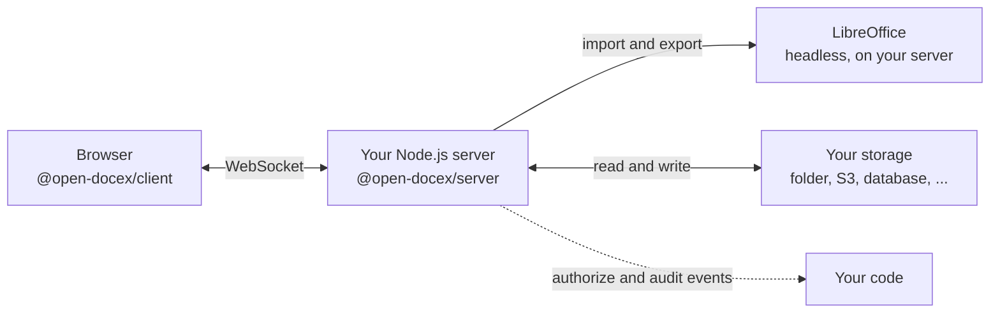

# open_docex

**Real-time collaborative document editing that you run yourself.**

open_docex lets many people edit the same Word-style document (`.docx` or `.odt`) at the same time, inside **your own application**, on **your own servers**, with the files kept **wherever you decide**. No third-party document service sits in between.

It is a set of npm packages for developers. It is not a hosted service and not a finished office suite: you add it to your backend and to a web page, and you keep control of everything around it.

> **Status: version 0.1.0, the first release.** It covers collaborative **text documents**. Spreadsheets and other items are planned (see [Roadmap](#roadmap)). Read [What it cannot do](#what-it-cannot-do-yet) before you decide.

## Purpose and who it is for

Google Docs and Microsoft 365 offer real-time co-editing, but only inside their own cloud: your documents are stored and processed on their servers, and sign-in, sharing and retention follow their rules. For some organisations that is not acceptable or not wanted, for example because of confidentiality or data-residency rules, an on-premises network, or the wish not to depend on one vendor.

open_docex gives such teams the collaboration engine and an editor, and leaves every decision about the documents to them. Its guiding rule is: **we provide the brain, not the storage.**

**What you control**

| You decide | How |
|---|---|
| **Where documents are stored** | A small storage adapter (four methods). A local folder adapter is included. For S3, a database or a file share you write the adapter, and the server README shows how. |
| **Who may open or edit what** | Your `authorize` callback runs for every connection and returns edit access, view-only access or a refusal. open_docex has no login, user list or sharing system of its own, by design. |
| **Where it runs** | In your own Node.js process, or in a separate worker process on your own machines. |
| **What is kept as an audit trail** | Change events are handed to your callback. You choose whether and where to store them. |
| **How the editor looks** | Theme variables, every label (for translation) and the toolbar items are configurable. |
| **What leaves your network** | A search of the source found no outbound network calls, and none of the packages' dependencies is a cloud client. The editor talks only to your server, and LibreOffice runs on your server. |

**Who it suits:** developers who build a product, portal, intranet or business system that needs collaborative document editing inside it, and organisations with rules about where their documents live.

**Who it does not suit:** anyone who wants a ready-to-use app or a hosted service (you build the login, the document list and the sharing yourself); anyone who needs full Google Docs or Word feature parity (see [What it cannot do](#what-it-cannot-do-yet)).

## How it works



- A user sees their own typing at once. The server puts every change in order, merges it with changes made at the same time (operational transformation), writes it to a local journal, and only then confirms it and sends it to the other users. Everyone ends up with the same document.
- The server saves the file to your storage a while after the last edit (30 seconds by default, and at least every 5 minutes while editing). If your storage is down, editing continues from the local journal and the server retries.
- If the engine crashes it restarts, and clients reconnect and resume.

## Requirements

| | |
|---|---|
| **Node.js** | 22, 24 or 26, ESM only. Tested in CI on all three on Ubuntu, and on 24 on Windows. |
| **LibreOffice** | Installed on the server. open_docex never bundles it (it is a separate program under MPL-2.0). Also install **LibreOffice Draw** and some fonts, for images in EMF, WMF, TIFF or SVG format. Tested with versions **26.2.7.3** and **26.8.3.1**. No minimum version has been established, so older versions are untested. |
| **Operating system** | **Linux** (Ubuntu) and **Windows** are tested in CI. **macOS has not been tested.** The code looks for LibreOffice in `/Applications/LibreOffice.app`, but that path has never been run. |
| **Browser** | Recent desktop **Chromium, Firefox and WebKit** are covered by automated tests (WebKit through Playwright, not Safari itself). Mobile browsers and touch input were not tested. |
| **Front end** | React 18.2 or 19 (a peer dependency of the client) and a bundler that handles ESM and CSS, such as Vite or webpack. |
| **Network** | An `http` or `https` server of yours to attach the engine to. Use `wss:` (TLS) in production. |
| **Disk** | A writable `dataDir` for the journal and local copies, plus your document storage. |

## What you can do

- **Edit `.docx` and `.odt` documents together in real time.** Each user's typing appears at once, and the others see it live.
- **Text formatting:** bold, italic, underline, strikethrough, font family and size, text colour, and links (`http`, `https` and `mailto` only).
- **Paragraphs:** headings, alignment (left, centre, right, justify), indents, spacing before and after, and line height.
- **Lists:** bulleted and numbered.
- **Tables:** insert, add and delete rows and columns, merge and split cells, header rows and column resizing.
- **Images:** PNG, JPEG and GIF by toolbar, paste or drag and drop, with resizing and alt text. EMF, WMF, TIFF and SVG images in files you open are converted to PNG (the user sees a notice).
- **Page layout:** page breaks, headers and footers with page-number and page-count fields, and page setup (size presets A4, Letter, Legal, A3 and A5, orientation and margins). The page is drawn as pages on screen.
- **View-only access** for some users, and a per-change check (`canSubmit`).
- **Open any storage:** a built-in folder adapter, or your own for any other place.
- **Survive failures:** reconnect and resume after a dropped connection, a journal that recovers acknowledged changes after an engine crash, and clear states (LOCAL, PENDING, CONFLICT) with `recovery.resolve` when your storage fails or its file was changed by someone else.
- **Audit:** change events delivered at least once, with a `replayed` flag after a crash.
- **Customise** the theme, the labels and the toolbar, and **handle errors** through a documented error-code catalogue.

## What it cannot do (yet)

- **Text documents only.** No spreadsheets in 0.1.0.
- **No undo or redo.** The editor disables Ctrl+Z and Ctrl+Y on purpose in this version.
- **No comments, tracked changes, footnotes, text boxes, equations or charts.** A file that contains such parts opens **read-only**, with a banner. If you allow "edit anyway", those parts are **removed when the document is saved**.
- **No other users' cursors or names.** You see their edits live, but there is no presence indicator or list of who is online.
- **Style names are not kept.** Named paragraph styles are flattened to direct formatting on import, and an indent set inside a list item is not kept on save.
- **One server per document.** The queue is in memory. Running two servers on the same document makes the copies diverge, and routing a document to one server is up to you. Redis and Kafka queues are planned.
- **No login, sharing links, document list or user management.** You provide them through `authorize`.
- **Limited capacity per process.** Measured on one Windows machine, one process held 8,000 idle connections, and about 1,000 active typists kept acknowledgements under 100 ms (2,000 did not). See [the benchmark](https://github.com/iNew-b-yte/open_docex/blob/main/docs/benchmarks/V1.md). Per-user rate limits are not included.

**Not tested** (it may work, but nobody has checked): macOS, LibreOffice older than 26.2, Safari itself, mobile browsers and touch input, input methods (IME) for languages such as Chinese or Japanese, right-to-left text, and screen readers or other accessibility tools.

## Quick start

Install LibreOffice on the server, then:

```sh
npm install @open-docex/server          # on the server
npm install @open-docex/client react react-dom   # in the web app
```

**Server.** A worker config module (the engine loads it in its worker process), then your server:

```js
// worker-config.mjs
import { mkdirSync } from 'node:fs';
import { fileURLToPath } from 'node:url';
import { defineWorkerConfig, LocalFsStorage } from '@open-docex/server';

const files = fileURLToPath(new URL('./files', import.meta.url));
mkdirSync(files, { recursive: true });

export default defineWorkerConfig({
  storage: new LocalFsStorage({ root: files }),
  dataDir: fileURLToPath(new URL('./data', import.meta.url)),
});
```

```js
// server.mjs
import http from 'node:http';
import { createEngine } from '@open-docex/server';

const server = http.createServer();
let ref; // the storage ref of the document to open

const engine = await createEngine({
  workerConfigModule: new URL('./worker-config.mjs', import.meta.url),
  http: { server, path: '/open-docex' },
  authorize: async ({ request, documentId }) => {
    const cookie = request.headers.cookie ?? '';
    if (!cookie.includes('session=')) return { deny: 401 };   // replace with your real check
    if (documentId !== 'demo') return null;                    // 403
    return { userId: 'u1', access: 'edit', document: { ref, format: 'docx' } };
  },
});

({ ref } = await engine.documents.create({ kind: 'text', format: 'docx', name: 'Demo', target: 'storage' }));
server.listen(3000);
```

**Browser** (bundle it with Vite, webpack or similar):

```js
import { mount } from '@open-docex/client';
import '@open-docex/client/style.css';

const editor = mount(document.getElementById('editor'), {
  url: 'wss://app.example.com/open-docex',
  documentId: 'demo',
  kind: 'text',
});
editor.on('ready', ({ access, readOnly }) => console.log('ready', access, readOnly));
```

The full options, authentication choices, storage adapters, events, recovery and error codes are in the package guides below.

## Packages

All three share one version number and must be the same release.

| Package | Runs in | What it is | Guide |
|---|---|---|---|
| [`@open-docex/server`](https://github.com/iNew-b-yte/open_docex/tree/main/backend) | Node.js | The engine: WebSocket gateway, merge and ordering, journal, storage, LibreOffice conversion, recovery, audit | [Server guide](https://github.com/iNew-b-yte/open_docex/blob/main/backend/README.md) |
| [`@open-docex/client`](https://github.com/iNew-b-yte/open_docex/tree/main/frontend) | Browser | `mount()` puts the editor in your page (React and ProseMirror inside) | [Client guide](https://github.com/iNew-b-yte/open_docex/blob/main/frontend/README.md) |
| [`@open-docex/shared`](https://github.com/iNew-b-yte/open_docex/tree/main/shared) | Both | The protocol, error catalogue and text model they share. Most people never install it directly | [Shared guide](https://github.com/iNew-b-yte/open_docex/blob/main/shared/README.md) |

## Roadmap

Planned, with no dates. Each item is a separate later version.

- **Spreadsheets** with the same collaboration.
- **Redis and Kafka queues**, in place of the in-memory queue.
- **Upload by end users** through the editor interface.
- **Bookmarks and side notes or reviews** on text documents.

## More documents

- [CHANGELOG](https://github.com/iNew-b-yte/open_docex/blob/main/CHANGELOG.md) for what is in each release.
- [Benchmark report](https://github.com/iNew-b-yte/open_docex/blob/main/docs/benchmarks/V1.md) for the measured capacity and how it was measured.
- Design: [HLD](https://github.com/iNew-b-yte/open_docex/blob/main/HLD.md) and [LLD](https://github.com/iNew-b-yte/open_docex/blob/main/LLD.md).

## Licence

[MIT](https://github.com/iNew-b-yte/open_docex/blob/main/LICENSE). LibreOffice is a separate program with its own licence (MPL-2.0) and is never bundled.
